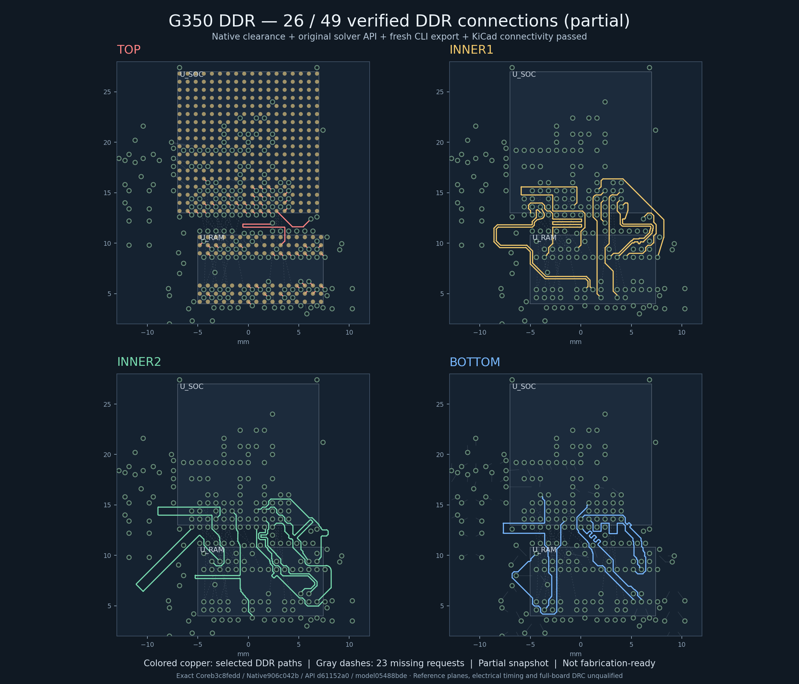

# G350 Linux DDR checkpoint: 26 of 49 connections

Source26 is the current checked **partial** routing checkpoint. Fresh editable
source, all 29 Core controls, all 18 native physical checks, the original Bus
Lanes API checks, a fresh pinned CLI export, and independent KiCad 10.0.6
connectivity verification passed. **23 DDR connections remain missing.
fabricationReady=false.** No fabrication files were released.



The snapshot is plotted from the exact checked Core/native/API data, with the
collected KiCad result bound by hash. Colored traces are checked DDR paths;
gray dashes are missing connections. Reproduce it with
`python3 scripts/plot-g350-source26-ddr.py` after restoring its pinned inputs.

The CPU and RAM retain their existing dogbone escapes. This candidate adds
DDR_RESETn on Bottom and DDR_D2 on Inner1, moving D2's existing CPU barrel to
`(6.2, 12.4)` mm. It adds no physical via. The checked board has four copper
layers, 280 real parts, 507 KiCad footprints, 227 standard through-vias, 289
physical traces and 1,001 nonzero copper segments. KiCad independently finds
26 genuine CPU-to-RAM graphs and verifies all 98 local signal approaches.

The user permits DDR signals on all four layers with redesigned references.
This differs from the TI four-layer Top/Bottom signal arrangement with two
continuous inner reference planes. Continuous references, impedance, return
paths, electrical delay, complete DDR routing, complete board qualification and
exact shell fit are still open. The KiCad check did not save, refill, repair or
edit the export, and did not run every KiCad design rule.

Loaded, incomplete planar cohorts pass their original software constraints:
Byte0 (6 signals) spans 0.527591 mm, Byte1 (11) 0.627102 mm and command/clock
(8) 0.085443 mm. These are not full 49-signal or electrical timing results.
Read `TI_DDR_SOURCE24_ELECTRICAL_TIMING_GAP_2026-10-15.md` for the unresolved
stackup, via-depth, package and propagation-delay model. The chosen planning
defaults remain a 400 MHz RAM clock and nominal 1.6 mm four-layer board.

Reset's current geometry passes the existing native checks. A subsequent
source-only candidate conservatively increases its foreign-class spacing and
removes a close nonlocal self approach; assigning Reset to the same software
group does not itself establish a TI spacing exception. That candidate also
adds three command/address routes. It remains unexecuted at this checkpoint.

## Actual Linux validation

All 52 SDK scopes are collected and closed. The final KiCad attempt used tool
session 63739, wrapper exit 0; zone-pin and CAD children both ended naturally
with exit 0. Root independently observed both process groups empty and the
guard absent. The owned worker observed container cleanup. Dependency/source
hashes, Git metadata and resource floors held; there were no OOM events.
Docker VFS free space reached 442,232,832 bytes, above the 128 MiB floor.

| Stage | Actual result |
| --- | --- |
| Capture, strict types, fresh Core | Scope48/tool60108: three serial children, all pass; Core29 controls |
| Native | Scope49/tool5044: 18 physical checks zero; 26 graphs, 23 missing |
| Fresh full49 model and original API | Scope50/tool14954: 49 unseeded requests; 119 boolean predicates, both DQS1 views pass |
| Fresh CLI export | Scope51/tool14495: pinned CLI exit0, byte-identical Core input |
| Independent KiCad | Scope52/tool63739: 26 graphs, 98 local approaches, exact 289-trace bijection |

Core JSON SHA256:
`b3c8fedd01b49143ba5edff44e83ae97d20ee1412b0afe450ea0bc2e9783cc64`.
KiCad export SHA256:
`c2ab45589d8bfd06bf6ba821c1a03e74b6e25fe4b84893cb2aa031ad850af35e`.
KiCad report SHA256:
`5ff4d01b233d80f4d173a95fc4056303fabea1fd260c972cc2e81fda2a550a53`.
Collected Root receipt SHA256:
`c7cae744e6ebef49cc37e0e36fb777ce7cd27702f0caf60b5b3fdd497d491191`.

The first scope52 preparation attempt (tool26079) stopped before importing any
helper or SDK: its input walker treated two explicitly future-created metadata
paths as existing files. That failed attempt remains recorded. The tested fix
validates those exact two metadata records and excludes only that list from
the concrete input walk; all actual file pins remain enforced. The CAD wrapper
also now supports the two exact pinned flat-file read-only inputs, alongside
the existing directory mounts. Neither fix changes hardware or checker rules.

## Continue safely

In every shell, `source /workspace/g350-linux-handheld/cloud/env.sh`. Keep the
lockfile runtime and reviewed native checks patch; attached upstream source is
for inspection. Preserve frozen evidence and all four pre-existing modified
user files. The current source manifest is
`.cloud-tools/ddr-source26-reset-source3-editable-source-stages-sourceonly-next/SOURCE-manifest.json`
(SHA256 `126266323739fb916b0ba1180b61265f23078a32af5938de61a24318bc57dbba`).
Use the latest continuation journal in the Bus Lanes checkout for work newer
than this report. Historical receipts are data and confer no execution authority.
Keep all broader hardware and electrical acceptance flags false.

The committed `g350-ti-ddr-source26-through-cad52-source-data-2026-10-15`
archive/index in `cloud/artifacts` adds 171 regular source/data files (35,171,929
logical bytes; 2,455,631 compressed bytes). Its restorer is
`scripts/restore-g350-source26-through52-source-data.py`. Restore the preceding
Source23/Source24 chains first as documented in the Source24 checkpoint; this
extension verifies all 386 exact prerequisites, including all 32 through47 files.
Its 20 actual restoration controls passed, including fresh two-root recovery,
idempotence, tampering, symlink/collision refusal and predecessor verification.
The actual default restore also passed: 171 existing exact files, zero created.
See the committed `TI_DDR_SOURCE26_THROUGH52_RESTORE_TEST_2026-10-15.json`
and `TI_DDR_SOURCE26_THROUGH52_LIVE_RECHECK_2026-10-15.json` reports.
Private authority/nonce/BOUND bodies, SDKs, image archives, duplicate snapshots
and resource telemetry are excluded. Historical receipts are restored as data.

After the predecessor chains, run:

```bash
source cloud/env.sh
python3 scripts/restore-g350-source26-through52-source-data.py \
  --manifest cloud/artifacts/g350-ti-ddr-source26-through-cad52-source-data-2026-10-15.manifest.json \
  --manifest-sha256 264cda5a1855071306af251c8d784b9fb313b94ca836a8a66717a19a8dddf240 \
  --archive cloud/artifacts/g350-ti-ddr-source26-through-cad52-source-data-2026-10-15.tar.gz \
  --base-manifest cloud/artifacts/g350-ti-ddr-source23-core-native-cli-cad-public-failure-2026-10-14.manifest.json \
  --source24-api-manifest cloud/artifacts/g350-ti-ddr-source24-through-api-source-data-2026-10-15.manifest.json \
  --source24-cli45-manifest cloud/artifacts/g350-ti-ddr-source24-cli-cad-delta-source-data-2026-10-15.manifest.json \
  --source24-through47-manifest cloud/artifacts/g350-ti-ddr-source24-cad46-cad47-small-source-data-2026-10-15.manifest.json \
  --restore
```

The later Source29 capture/types/Core batch53 also passed, with all 29 Core
controls and 1,053 segments. Its Native/API/CLI/CAD checks are still pending;
it does not replace this independently checked 26-route milestone.
