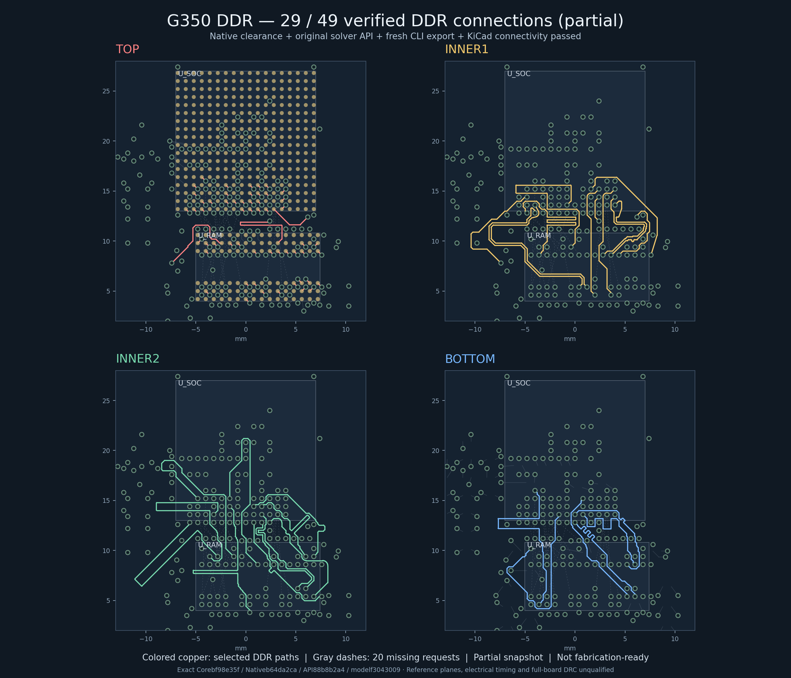

# G350 DDR Linux checkpoint: 29/49 connections

The current accepted partial checkpoint is **29/49 DDR connections, with 20 missing**. It preserves the 280 hardware parts and all 98 CPU/RAM dogbone approaches. The new connections are DDR_BA0 (Inner2), DDR_A3 (Inner1), and DDR_RASn (Inner2). DDR_A3 includes its reviewed RAM dogbone relocation; the reset-route correction is retained.

This snapshot uses DDR signals on all four copper layers as requested. Reference planes, impedance, electrical timing, full-board DRC, shell fit, and fabrication remain unqualified. **`fabricationReady` remains false.** The engineering image shows colored checked copper and 20 dashed missing requests.

Fresh Linux verification completed in separate stages:

| Stage | Result |
| --- | --- |
| 53: editable source capture, strict types, fresh Core | All three serial children passed; 29 Core predicates passed |
| 54: reviewed native checks | All 18 checks returned zero findings |
| 55: fresh unseeded 49-request model and original solver APIs | 131 predicates passed; no completed DDR bodies seeded into the public input |
| 56: pinned tscircuit CLI | Fresh unedited KiCad export passed |
| 60: KiCad 10.0.6 connectivity | 29 physical CPU-to-RAM graphs and all 98 local approaches passed |

KiCad independently loaded 227 vias, 1,053 segments and four copper layers. All 292 source traces mapped bijectively; two hardware keepouts were retained. These are partial geometry and connectivity checks, not complete hardware qualification. The checker flags claiming complete acceptance were preserved as false; Root recorded the partial 29-connection adoption separately.

Current **planar** loaded-cohort skew:

| Group | Present | Skew (mm) | Limit (mm) |
| --- | --- | --- | --- |
| Byte 0 | 6 | 0.527591 | 0.635 |
| Byte 1 | 11 | 0.627102 | 0.635 |
| Command/clock | 11 | 0.485443 | 0.635 |

The largest differential-pair planar skew is 0.083221 mm against 0.127 mm. Only Byte 1 has its complete eleven-signal cohort. Incomplete cohorts and unmatched layer propagation delays prevent an electrical timing pass. The 400 MHz / nominal 1.6 mm assumptions are not a qualified manufacturer stackup.

Validation attempts 57 and 58 stopped before the CAD wrapper could start because the unchanged memory-admission check lacked headroom. Attempt 59 started its container but failed before loading the PCB: three authentic per-phase Core validation records were absent from the read-only snapshot. Attempt 60 added exactly those three pinned public records (38 to 41 files). The five CLI/CAD workers, runtime versions, checks, resource limits, frozen hardware evidence and raw export stayed unchanged. All owned processes and containers were collected and independently observed closed.

The [portable source/data archive](artifacts/g350-ti-ddr-source29-through-cad60-source-data-2026-10-15.tar.gz) contains 466 regular files and requires the exact 557 preserved predecessor files. Its [index](artifacts/g350-ti-ddr-source29-through-cad60-source-data-2026-10-15.manifest.json) and [restorer](../scripts/restore-g350-source29-through60-source-data.py) preserve the prior evidence. All [20 restore and rejection controls](artifacts/g350-source29-through60-restore-test-report-2026-10-15.json) passed; a [live idempotent restore](artifacts/g350-source29-through60-live-restore-report-2026-10-15.json) verified all 466 files and created none. Restoring historical records does not create Root authority or qualify a new execution. No SDK, image, private authority, or frozen evidence is repackaged by this extension.

Public checkpoint identities:

- Editable source manifest: `00421ca4aba188174b657a0787367231e19c7a4c2b1cade7e0f548378cbf1c5a`.
- Fresh Core: `bf98e35f464bee13d60fa413f3055af178f2d50735bbeef9a891672ba8fa4e37`.
- CAD60 report: `08fc1078ac6ba2d4b8b89f64ff58ed27429f8ebe32e683b49322e69c825eb305`.
- Collected CAD60 receipt: `c9b66491f3cfaa6956f86716c25b373a80149325a29e636273295ff7450ee754`.
- Separate partial-adoption record: `30f558db01acfe86c21446921c40d0e1ac70004aa7b6ccdef1a1883f7fc4debd`.

Continue from `codex/cloud-handoff`, source `cloud/env.sh`, and read the latest Root continuation journal before running a worker. The prepared Source32 and corrected DDR_D3 geometry are future candidates; this checkpoint does not accept them. Solver regression tests and the original eleven-case benchmark must pass before publishing the stacked fix PR.
